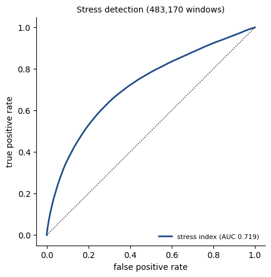
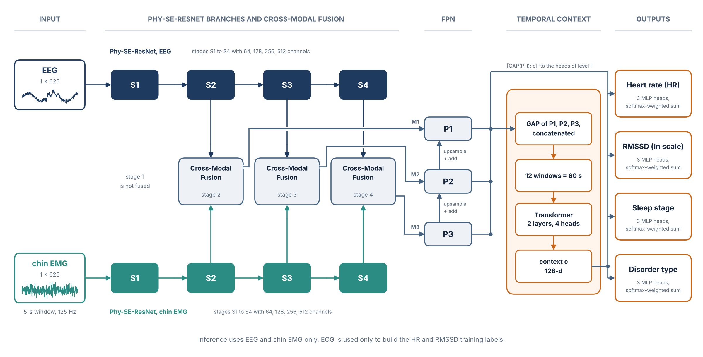

# PMRT-SleepStress

<p align="center">
  
  
  
  
</p>

**PMRT-SleepStress** estimates a physiological stress index during sleep from **EEG and chin EMG only**. One multi-task network reads 5-s windows and predicts heart rate, heart-rate variability, sleep stage and sleep-disorder type. ECG is used to build the training labels and is never a model input.

## Highlights

- **No ECG at inference.** EEG and chin EMG are recorded in every polysomnography, so the model works where ECG is missing or noisy.
- **One network, four outputs:** HR, ln RMSSD (together a stress index), sleep stage, disorder type.
- **60-s temporal context:** a small Transformer shares information between 12 consecutive windows.
- **Compared on one protocol:** seven other methods, same subject-wise folds, windows and labels.
- **Checked on external data:** 100 subjects of PhysioNet/CinC Challenge 2018, no retraining.

---

## Results

CAP Sleep Database, 103 subjects, 5-fold subject-wise cross-validation, all test folds pooled.

| Task | Metric | PMRT |
|---|---|---|
| Heart rate | MAE (bpm) | **4.30** (median baseline 7.72) |
| Heart rate | Pearson r | 0.73 |
| Stress detection | AUC | 0.72 |
| Sleep stage (4 classes) | accuracy / kappa | 0.75 / 0.63 |
| Healthy vs disorder | AUC | 0.82 |
| Disorder (6 classes) | balanced accuracy | 0.38 (chance 0.17) |

**External data (CinC 2018, 100 subjects):** HR MAE 4.26 bpm, stress AUC 0.74, stage kappa 0.534. Confidence intervals: [`results/external_validation_cinc2018.csv`](results/external_validation_cinc2018.csv).

### Comparison with other methods

Same folds, windows and labels for every method ([`results/tableB01_comparison_same_protocol.csv`](results/tableB01_comparison_same_protocol.csv)).

| Method | HR MAE | Stress AUC | Stage kappa | Disorder bal. acc | Healthy vs disorder AUC |
|---|---|---|---|---|---|
| Sharma et al. 2021 (EEG) | 7.59 | 0.580 | 0.431 | 0.264 | 0.701 |
| Sharma et al. 2022 (EMG) | 7.92 | 0.531 | 0.123 | 0.224 | 0.806 |
| Band power + Random Forest | 7.75 | 0.575 | 0.495 | 0.286 | 0.732 |
| EEGNet (Lawhern et al. 2018) | 7.41 | 0.590 | 0.515 | 0.299 | 0.753 |
| AttnSleep (Eldele et al. 2021) | 7.67 | 0.587 | 0.501 | 0.275 | 0.785 |
| TinySleepNet (Supratak and Guo 2020) | 6.30 | 0.646 | 0.605 | 0.295 | 0.616 |
| Cheng et al. 2023 | 5.02 | 0.695 | 0.521 | **0.399** | 0.750 |
| **PMRT (this repo)** | **4.30** | **0.719** | **0.626** | 0.378 | **0.815** |

Cheng et al. is ahead on 6-class disorder accuracy and macro F1. A paired per-subject Wilcoxon test against TinySleepNet gives HR MAE better in 90 of 103 subjects (p = 2.7e-12); stage accuracy does not differ significantly (p = 0.168); stage kappa p = 0.042 without multiple-comparison correction.

<p align="center">
  
  
</p>

---

## How it works

<p align="center">
  
</p>

1. **Input.** EEG and chin EMG, band-pass filtered and resampled to 125 Hz, cut into 5-s windows (1 x 625 per channel).
2. **Two branches.** A Phy-SE-ResNet per modality; features from stages 2 to 4 are kept.
3. **Cross-Modal Fusion** at each of those stages, then a **feature pyramid** (P1, P2, P3).
4. **Temporal context.** The pooled P1 to P3 features of 12 consecutive windows go through a Transformer (2 layers, 4 heads) and give a 128-d context vector for each window.
5. **Multi-scale heads.** For each task, three MLP heads (one per pyramid level) take the pooled level features and the context; their outputs are combined by a softmax-weighted sum.

9.96 M parameters. Training uses subject-balanced sampling, signal augmentation, label smoothing, weight decay, EMA of the weights (0.999) and early stopping. Two checkpoints are kept per fold: one by validation stress score, one by subject-level disorder loss.

---

## Data and labels

[CAP Sleep Database](https://physionet.org/content/capslpdb/1.0.0/) (PhysioNet, Open Data Commons Attribution License v1.0): 103 subjects, 483,170 windows of 5 s at 125 Hz. Download and preprocessing steps are in [`data/README.md`](data/README.md).

| Label | How it is built |
|---|---|
| HR | RR intervals of the 5-s window from ECG (at least 3 beats) |
| ln RMSSD | RR intervals of the surrounding 60 s |
| Stress index | `SI = z(HR) - z(RMSSD)`, z-scored inside each record; stress if `SI > 1` (24.2% of windows) |
| Sleep stage | N1, N2, N3, REM from the expert hypnogram |
| Disorder | Healthy, NFLE, RBD, PLM, Insomnia, Narcolepsy (SDB and Bruxism have too few subjects for this head) |

Equal weights and the threshold 1 in the stress index are assumptions of this work, not taken from a source.

---

## Quick start

```bash
pip install -r requirements.txt

# check the installation without the dataset (synthetic data, CPU, about a minute)
python tests/smoke_test.py

# 1. preprocessing: run notebooks/cap_download.ipynb and notebooks/cap_preprocessing.ipynb
#    (one .npz per record)

# 2. merge into x.npy + index.csv
python main.py build-cache --npz-dir /path/cap_processed --cache-dir /path/cap_dataset_cache

# 3. 5-fold subject-wise training (resumable; a GPU is strongly recommended)
python main.py train --cache-dir /path/cap_dataset_cache --run-dir runs/pmrt_mt3_cv5
```

`train` writes `runs/.../fold{k}/test_pred.csv` for every fold. Metrics, bootstrap intervals and the stress validation are computed from these files in `notebooks/pmrt_multitask_cv_v3.ipynb` (sections 9 to 11). Trained checkpoints are not included.

### Notebooks

The notebooks are the runs behind the numbers above. Set the data root path (`ROOT`) in their first cell before running them.

| Notebook | Content |
|---|---|
| `cap_download`, `cap_preprocessing` | download, filtering, windows, HR / RMSSD labels |
| `pmrt_multitask_cv_v3` | final model: training, evaluation, stress validation |
| `pmrt_baselines`, `pmrt_baselines_tinysleepnet_kaggle` | other methods on the same protocol |
| `pmrt_plaincnn`, `pmrt_plaincnn_ctx` | plain CNN without and with temporal context |
| `pmrt_ablation_fusion`, `pmrt_ablation_kaggle` | EEG + EMG vs EEG only vs EMG only |
| `pmrt_module_ablation_oneconv_executed` | with and without the feature extractor |
| `pmrt_external_validation_cinc2018_executed` | external validation on CinC 2018 |

---

## Project structure

```
PMRT-SleepStress/
├── main.py                  # build-cache, train
├── configs/config.py        # constants and hyper-parameters
├── data/                    # cache, folds, batch iterators, augmentation
├── models/                  # Phy-SE-ResNet, fusion, PMRT with temporal context
├── src/                     # losses, training loop, evaluation, EMA
├── tests/smoke_test.py      # end-to-end check on synthetic data
├── notebooks/               # experiments
├── tables/                  # 22 result tables of the final model
├── results/                 # comparison, ablations, external validation
└── assets/                  # banner, figures
```

---

## Limitations

- One seed per experiment. Bootstrap intervals resample subjects and do not capture training variance.
- Few subjects in the disorder classes (Narcolepsy 5, Insomnia 9, PLM 10); the 6-class result is weak.
- The stress label comes from ECG and is relative to each subject's own night. RMSSD is predicted poorly (r = 0.21), so the stress index is mostly driven by HR.
- Possible ECG leakage into the chin EMG channel was not checked.
- One external dataset only.
- Ablations show most of the gain comes from the overall framework (multi-task learning, temporal context, fusion), not from the Phy-SE feature extractor. The separate contribution of Fusion and FPN was not measured.

---

## License

MIT. The CAP Sleep Database keeps its own license (Open Data Commons Attribution License v1.0).
