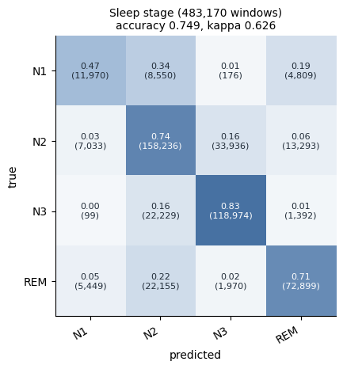

# PMRT-SleepStress


Multi-task deep learning on sleep **EEG + chin EMG** to estimate heart rate, heart-rate variability, a physiological stress index, sleep stage and sleep-disorder type, without using ECG as an input.

---

## Overview

During sleep, ECG is rarely available outside a sleep lab, while EEG and chin EMG are recorded in every polysomnography. This project trains one network that reads 5-s windows of EEG and chin EMG and predicts, for each window:

- **HR** (bpm) and **ln RMSSD**, which together define a stress index
- **sleep stage** (N1, N2, N3, REM)
- **disorder type** (6 classes, per subject after averaging the night)

ECG is used **only to build the HR and RMSSD labels**. It is never a model input.

The network follows the PMRT design and adds a 60-s temporal context:

```
EEG (1x625) ───────► Phy-SE-ResNet ─┐
                                      ├─► Cross-Modal Fusion (stages 2-4) ─► FPN (P1, P2, P3)
chin EMG (1x625) ───► Phy-SE-ResNet ─┘                                         │
                                                                              ▼
 12 consecutive windows (60 s) ─► Transformer (2 layers, 4 heads) ─► context c (128-d)
                                                                              │
 per task (HR, RMSSD, disorder, stage): 3 MLP heads on [GAP(P_l); c], one per FPN level,
 combined by a softmax-weighted sum
```

9.96 M parameters. Training uses subject-balanced sampling, signal augmentation, label smoothing, weight decay, EMA of the weights (0.999) and early stopping; two checkpoints are kept per fold (stress score and subject-level disorder loss).

---

## Dataset

[CAP Sleep Database](https://physionet.org/content/capslpdb/1.0.0/) (PhysioNet, Open Data Commons Attribution License v1.0): 103 subjects used, 483,170 windows of 5 s at 125 Hz.
External check: 100 subjects of the PhysioNet/CinC Challenge 2018 data. Download and preprocessing steps: [`data/README.md`](data/README.md).

**Stress index.** `SI = z(HR) - z(RMSSD)`, z-scored inside each record on raw RMSSD; stress if `SI > 1` (24.2% of windows). Equal weights and the threshold are assumptions of this work.

---

## Evaluation protocol

5-fold subject-wise cross-validation (stratified by diagnostic group, each subject tested once). For each fold: 3 folds train, 1 validation, 1 test. One seed (42).

---

## Results

Final model (v3), CAP Sleep Database, all 103 subjects pooled over the test folds:

| Task | Metric | Value |
|---|---|---|
| Heart rate | MAE | 4.30 bpm (median baseline 7.72) |
| Heart rate | Pearson r | 0.73 |
| Stress detection | AUC | 0.72 |
| Sleep stage (4 classes) | accuracy / kappa | 0.75 / 0.63 |
| Healthy vs disorder | AUC | 0.82 |
| Disorder, 6 classes | balanced accuracy | 0.38 (chance 0.17) |

External data (CinC 2018, 100 subjects, no retraining on it): HR MAE 4.26 bpm, stress AUC 0.74, stage kappa 0.534 (95% CIs in [`results/external_validation_cinc2018.csv`](results/external_validation_cinc2018.csv)).

### Comparison under the same protocol

All methods use the same folds, windows and labels ([`results/tableB01_comparison_same_protocol.csv`](results/tableB01_comparison_same_protocol.csv)).

| Method | HR MAE | Stress AUC | Stage kappa | Disorder bal. acc | Healthy vs disorder AUC |
|---|---|---|---|---|---|
| Sharma et al. 2021 (EEG) | 7.59 | 0.580 | 0.431 | 0.264 | 0.701 |
| Sharma et al. 2022 (EMG) | 7.92 | 0.531 | 0.123 | 0.224 | 0.806 |
| Band power + Random Forest | 7.75 | 0.575 | 0.495 | 0.286 | 0.732 |
| EEGNet (Lawhern et al. 2018) | 7.41 | 0.590 | 0.515 | 0.299 | 0.753 |
| AttnSleep (Eldele et al. 2021) | 7.67 | 0.587 | 0.501 | 0.275 | 0.785 |
| TinySleepNet (Supratak & Guo 2020) | 6.30 | 0.646 | 0.605 | 0.295 | 0.616 |
| Cheng et al. 2023 | 5.02 | 0.695 | 0.521 | **0.399** | 0.750 |
| **PMRT (this repo)** | **4.30** | **0.719** | **0.626** | 0.378 | **0.815** |

Cheng et al. is ahead on 6-class disorder accuracy and macro F1. Paired per-subject Wilcoxon test against TinySleepNet: HR MAE better in 90 of 103 subjects (p = 2.7e-12); stage accuracy not significantly different (p = 0.168); stage kappa p = 0.042 without multiple-comparison correction.

<p align="center">
  
  
</p>

### Limitations

- One seed per experiment. Bootstrap CIs resample subjects, so they do not capture training variance.
- Few subjects in the disorder classes (Narcolepsy 5, Insomnia 9, PLM 10); the 6-class result is weak.
- The stress label comes from ECG and is relative to each subject's own night. RMSSD is predicted poorly (r = 0.21); the stress index is mostly driven by HR.
- Possible ECG leakage into the chin EMG channel was not checked.
- One external dataset only.
- Ablations show most of the gain comes from the overall framework (multi-task, temporal context, fusion), not from the Phy-SE feature extractor. The separate contribution of Fusion and FPN was not measured.

---

## Project structure

```
PMRT-SleepStress/
├── main.py                  # build-cache, train (5-fold CV)
├── configs/config.py        # constants and hyper-parameters
├── data/
│   ├── dataset.py           # cache, folds, batch iterators, augmentation
│   └── README.md            # dataset download and preprocessing
├── models/
│   ├── phy_se_resnet.py     # branch for one modality
│   ├── fusion.py            # Cross-Modal Fusion
│   ├── model.py             # FPN, multi-scale predictors, temporal context, PMRTTemporal
│   └── checkpoints/         # not tracked
├── src/
│   ├── losses.py            # target encoding, multi-task loss
│   ├── train.py             # one fold + 5-fold loop
│   ├── eval.py              # predict, validation scores
│   └── utils.py             # EMA
├── notebooks/               # the notebooks the reported numbers were produced with
├── tables/                  # 22 tables of the final model (CSV)
├── results/                 # model comparison, external validation, ablations
└── assets/results/          # ROC, confusion matrices, feature plots
```

---

## Usage

```bash
pip install -r requirements.txt

# 1. preprocessing: run notebooks/cap_download.ipynb and notebooks/cap_preprocessing.ipynb
#    (they produce one .npz per record)

# 2. merge into x.npy + index.csv
python main.py build-cache --npz-dir /path/cap_processed --cache-dir /path/cap_dataset_cache

# 3. 5-fold subject-wise training (resumable; a GPU is strongly recommended)
python main.py train --cache-dir /path/cap_dataset_cache --run-dir runs/pmrt_mt3_cv5
```

`train` writes `runs/.../fold{k}/test_pred.csv` for every fold. The final metrics, bootstrap intervals, stress validation (CAP A phases, threshold sensitivity) and the disorder analysis are computed from these files in `notebooks/pmrt_multitask_cv_v3.ipynb` (sections 9-11).

### Notebooks

The notebooks are the runs behind the numbers above. They were executed in a hosted notebook environment, so their first cell sets a data root path (`ROOT`) that you need to change, and several write their own copy of the model module before importing it. The package in `models/`, `src/` and `data/` contains the same model code split into files; `main.py train` mirrors section 7 of `pmrt_multitask_cv_v3.ipynb`.

| Notebook | Content |
|---|---|
| `cap_download.ipynb`, `cap_preprocessing.ipynb` | download, filtering, windows, HR / RMSSD labels |
| `pmrt_multitask_cv_v3.ipynb` | final model, 5-fold training, evaluation, stress validation |
| `pmrt_baselines.ipynb`, `pmrt_baselines_tinysleepnet_kaggle.ipynb` | comparison with other methods on the same protocol |
| `pmrt_ablation_fusion.ipynb`, `pmrt_ablation_kaggle.ipynb` | EEG + EMG vs EEG only vs EMG only |
| `pmrt_module_ablation_oneconv_executed.ipynb` | with / without the feature extractor |
| `pmrt_plaincnn.ipynb`, `pmrt_plaincnn_ctx.ipynb` | plain CNN without and with the temporal context |
| `pmrt_external_validation_cinc2018_executed.ipynb` | external validation on CinC 2018 |

### Training cost

About 76 s per epoch for the final model and 5-6 h per notebook run on the GPUs used here; the GPU of the main run was not recorded. Ablations and comparisons ran on a Tesla T4. Library versions were not recorded, so `requirements.txt` is not pinned.

### What is not in the repository

- Trained checkpoints and the test predictions of the final model.
- Baseline predictions for Sharma and Cheng (their results were read from earlier runs) and the cross-fitted stress-index table.
- Earlier model versions (v1, v2, single-task) and the Phy-SE, StdSE and single-conv ablations.
- `main.py` and the package were checked end to end only on small synthetic data on CPU, not on the full dataset.

---

## License

MIT. The CAP Sleep Database keeps its own license (Open Data Commons Attribution License v1.0).
